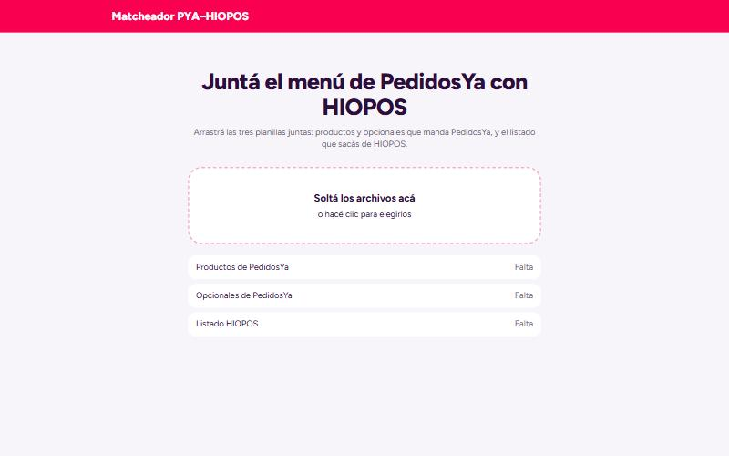
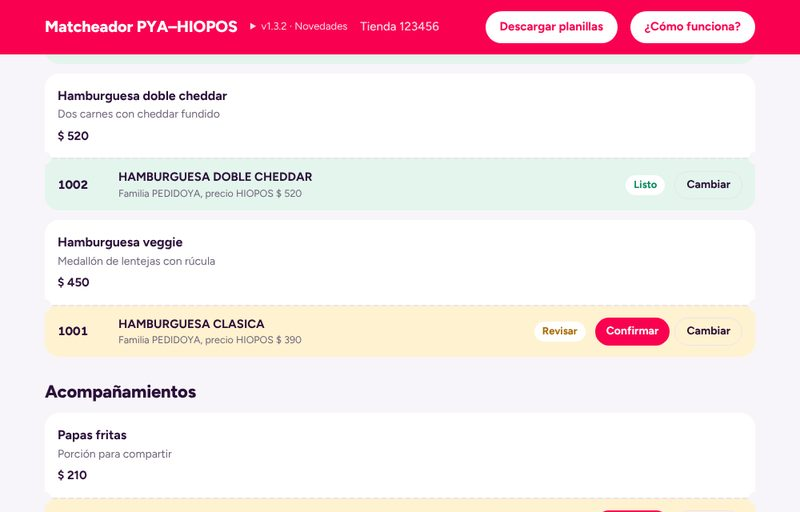
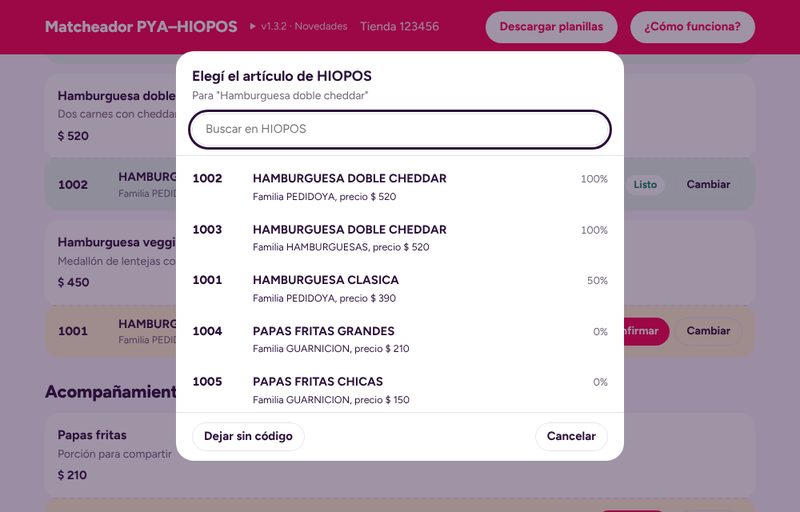
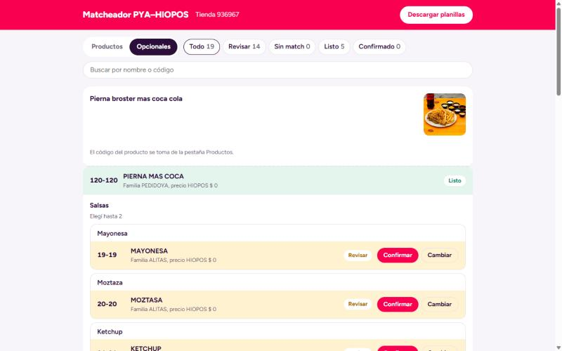

# Matcheador PedidosYa ↔ HIOPOS

Completa los SKU de las planillas que manda PedidosYa (productos y opcionales) con los códigos del listado HIOPOS (`Cód. PedidosYa`), para la integración PedidosYa–HIOPOS.

## Cómo se usa

Abrí `Para tecnicos/Matcheador.html` con doble clic. Es un solo archivo: no necesita instalación ni internet (sin conexión solo faltan las fotos de los productos) y las planillas se procesan en el navegador, no se suben a ningún lado.

La presentación completa está en [`docs/Presentacion Matcheador.pdf`](docs/Presentacion%20Matcheador.pdf).

### 1. Soltá las planillas

Arrastrá las tres planillas a la pantalla (o hacé clic para elegirlas): `productos-XXXX.xlsx` y `opcionales-XXXX.xlsx` que manda PedidosYa, y el listado exportado de HIOPOS. Reconoce cuál es cuál por su contenido, no por el nombre del archivo.

### 2. Revisá por colores

En la pestaña **Productos** se ve el menú como lo ve el cliente: cada producto de PedidosYa con su foto, descripción y precio, y debajo el artículo de HIOPOS sugerido (código, nombre, familia y precio). Con los filtros de arriba podés ver solo lo que falta.

| Color | Estado | Qué hacer |
|---|---|---|
| Verde | Listo | Match seguro, no hay que tocar nada. |
| Amarillo | Revisar | Hay más de un candidato parecido: mirá y tocá **Confirmar** o **Cambiar**. |
| Rojo | Sin match | No hay nada parecido en HIOPOS: tocá **Elegir**, o dejalo sin código y crealo en HIOPOS. |
| Violeta | Confirmado | Lo elegiste o confirmaste vos. |

Solo hay que detenerse en lo amarillo y lo rojo.

### 3. Cambiá el artículo con el buscador

**Cambiar** (o **Elegir**) abre todo el listado de HIOPOS ordenado por parecido, con el porcentaje de coincidencia de cada artículo. Arriba hay un buscador por nombre, código o familia. Si el artículo todavía no existe en HIOPOS, usá **Dejar sin código**; lo recomendable es crearlo en HIOPOS y volver a cargar las planillas.

### 4. Revisá los opcionales

En la pestaña **Opcionales** aparecen agrupados por producto, con sus grupos y cuántas opciones se pueden elegir. Cada opcional se elige una sola vez: corregir "Mayonesa" corrige todas las mayonesas de la carta. El `SKU Producto` se completa solo con el código del producto.

### 5. Descargá y enviá

Tocá **Descargar planillas**: bajan `productos-XXXX.xlsx` y `opcionales-XXXX.xlsx` con los SKU completos, listas para enviar a PedidosYa.

## Versión web

La herramienta se publica sola en GitHub Pages cada vez que se mergea algo a `main` (`.github/workflows/publicar.yml`). El link es fijo, se puede pasar a cualquiera y siempre abre la última versión.

Para sacar una versión nueva: agregá arriba de todo en `CHANGELOG.md` un `## X.Y.Z — fecha` con los cambios en `- `. Eso es lo que se ve en el panel "Novedades" de la app, y al publicarse se crea la etiqueta `vX.Y.Z` en git.

## Cómo matchea

Compara nombres palabra por palabra, ignorando acentos, mayúsculas, medidas ("600 g") y relleno ("más", "con", "para"), y tolera faltas de ortografía. Ante empate prefiere la familia `PEDIDOYA` y después el código más bajo. Los SKU que ya existen en HIOPOS se respetan. El `SKU Producto` de los opcionales se toma del producto.

Para casos que no reconoce, agregar variantes en `SINONIMOS` / `RELLENO`.

## Archivos

| Archivo | Qué es |
|---|---|
| `Para tecnicos/Matcheador.html` | La herramienta lista para usar (se genera, no editar). |
| `CHANGELOG.md` | Versiones y novedades. |
| `ejecutar.bat` | Versión por consola: lee `planillas/Recibidos PYA/` y `planillas/Listado HIOPOS/`, escribe en `planillas/Salida/`. |
| `planillas/` | Planillas de clientes para la consola y los tests. No se suben al repo y se pueden borrar cuando quieras. |
| `docs/` | Presentación (`Presentacion Matcheador.pdf`, se genera desde `presentacion.html` imprimiéndolo con Edge/Chrome) y capturas. |
| `codigo/matcheador.html` + `codigo/matcher.js` | Pantalla (fuente). |
| `codigo/empaquetar.py` | Arma `Para tecnicos/Matcheador.html` incrustando `matcher.js`, `vendor/xlsx.full.min.js` (SheetJS 0.18.5) y las novedades de `CHANGELOG.md`. Correrlo tras cada cambio. |
| `codigo/matcheador.py` | Lógica de la consola. |
| `codigo/test_matcheador.py` | Compara la salida contra `planillas/Enviados PYA/` (lo que se envió a mano). |
| `codigo/test_logica.py` | Pruebas de la lógica con datos inventados: `cd codigo` y `python -m unittest test_logica`. |
| `codigo/test_matcher.js` | Verifica que `matcher.js` y `matcheador.py` den lo mismo. |

**Las reglas viven en dos lugares** (`matcher.js` y `matcheador.py`): si cambiás una, cambiá la otra y corré `node codigo/test_matcher.js`.

Las planillas de clientes no están en el repo (`.gitignore`). Para correr los tests, poné una tienda de ejemplo en `planillas/Recibidos PYA/`, `planillas/Enviados PYA/` y `planillas/Listado HIOPOS/`.

Requisitos para desarrollar: Python 3 con `openpyxl`, y Node.
